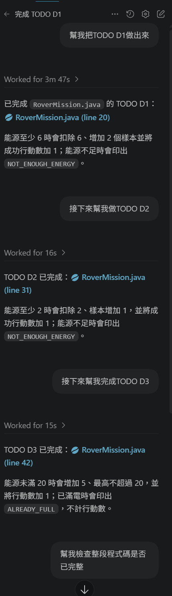

# 第三週 AI 使用紀錄

每欄簡短填寫即可，不必貼上完整對話。未使用 AI 時，第一欄填「未使用」及原因，其餘免填；講義要求的程式測試仍須完成。

若使用教師提供的模擬建議，第一欄填「教師模擬建議，未使用 AI 服務」，其餘依實際修改與測試填寫。

|欄位|記錄|
|-|-|
|使用工具|ChatGPT|
|使用目的與提問摘要|協助我完成作業並檢查|
|AI 建議與本人處理|TODO1~3完成並檢查完無誤|
|實際驗證結果|輸入、預期與實際結果一致|
### 附圖

